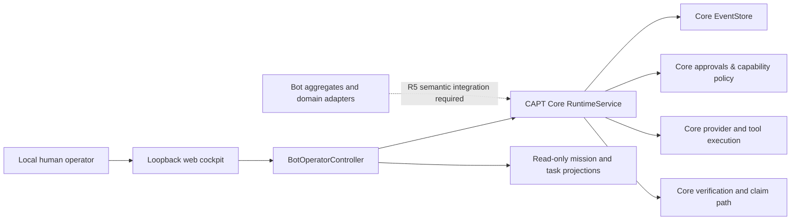

# Architecture — one CAPT authority, separately versioned Bot behavior

The **architectural invariant** is that CAPT-Bot contributes Bot-specific identity, cognition, collaboration and operator UX but CAPT Core remains the sole authority for execution, approvals, evidence, verification and claims. The R5 specification describes the intended completed integration; this document separates that objective from present source.

## Source-visible topology

`capt_bot/ui_server.py` hosts HTML/CSS/JS, performs exact Host/Origin checks, and relays structured requests. `capt_bot/operator.py` transforms UI actions into Core query/command operations. `capt_bot/mission_recovery.py` assembles read-only recovery evidence and drafts safe successor work; drafts cannot approve themselves.

## Responsibility boundaries

| Component | Owns | Does **not** own |
| --- | --- | --- |
| `capt_bot/ui/` | UI rendering/interaction | Runtime truth or authorization |
| `capt_bot/ui_server.py` | Local bridge and Core socket client | External/public web authentication service |
| `capt_bot/operator.py` | Operator request shaping, local validations | Permission grants or independent verification |
| `capt_runtime/aggregates/` in this repo | Bot, cognition, skill, delegation, Lab Board, sandbox lease domain semantics | Standalone production EventStore |
| `capt_runtime/tools/` in this repo | Bot-related adapters, cloud/sandbox backend implementations | Unrestricted external execution |
| CAPT Core | Admission, authoritative mutation, model/tool execution, evidence and claims | Bot's independently maintained product identity/UX |

## Critical source lineage

`SOURCE_PROVENANCE.json` and `integration/CAPT_CORE.patch` preserve historical extraction, not current installation guidance. Modern Core has evolved; semantic migration must classify each old shared hunk instead of overwriting modern Core. See [R5 Convergence](architecture/CAPT_BOT_CONVERGENCE_R5.md) for migration gates and [Data/contracts](DATA_AND_CONTRACTS.md) for static domain model references.

## Failure containment

A UI network disconnect is not proof of a failed/successful provider call. The Core client may retry **read-only queries** after a verified transport disconnect (`CoreRuntimePort.query`), but does **not** replay consequential commands. Approvals are session/task/driver-bound. Mission recovery drafts are explicitly non-executable.

**R5 end-to-end architecture remains unverified**, despite historical component tests. [Technical manual](TECHNICAL_MANUAL.md) · [Security model](SECURITY_MODEL.md).
